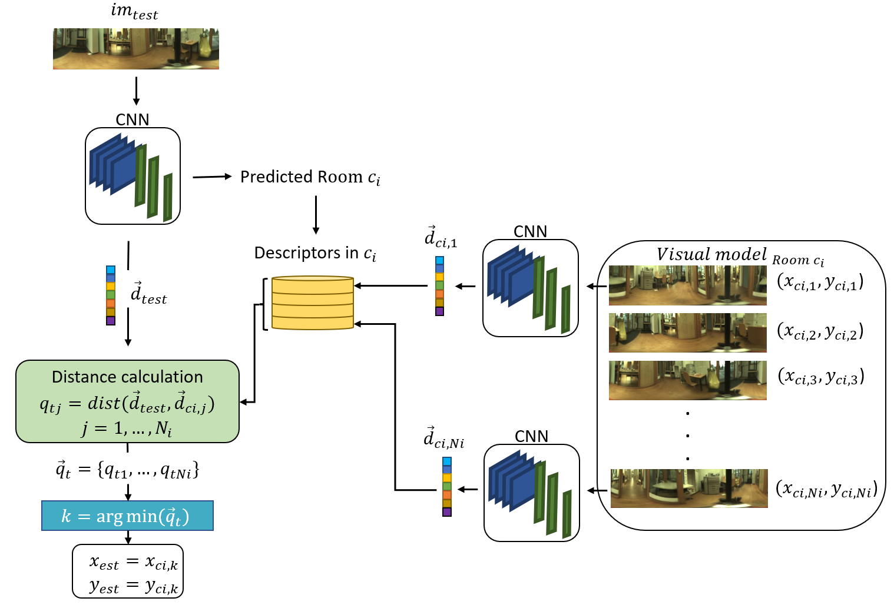

# ML_localization: Hierarchical Indoor Localization for Mobile Robots using CNNs

A deep learning framework for hierarchical visual localization of mobile robots using omnidirectional and panoramic imaging under challenging, dynamically changing indoor illumination conditions.



---

## 📌 Overview

Visual localization in real-world indoor environments remains a challenging problem due to substantial illumination changes, shadows, and viewpoint variations. This project implements a **Hierarchical Localization** pipeline that divides localization into two complementary stages:

1. **Coarse Localization (Room Retrieval):** A convolutional neural network (CNN) predicts the room or area from which a test image was captured ($R$ semantic classes).
2. **Fine Localization (Metric Pose Estimation):** A holistic global descriptor is extracted from an intermediate layer (Average Pooling / Latent activation map) of the retrained CNN. The nearest neighbor pose is estimated by pairwise Euclidean distance comparison against reference images from the pre-selected room's visual map.

---

## 📊 Experimental Results

Evaluated on the **COLD-Freiburg (COsy Localization Database)** benchmark across three distinct environmental lighting conditions:
- **Cloudy** (2,595 test images) — Diffused, uniform lighting (similar to training baseline).
- **Night** (2,707 test images) — Artificial ceiling lighting.
- **Sunny** (2,114 test images) — Challenging intense sunlight with sharp cast shadows and glare.

### Benchmark Performance Table

| Model Backbone | Training Variant | Cloudy MAE (m) | Cloudy Room Acc (%) | Night MAE (m) | Night Room Acc (%) | Sunny MAE (m) | Sunny Room Acc (%) | Latency / Image |
| :--- | :---: | :---: | :---: | :---: | :---: | :---: | :---: | :---: |
| **MobileNetV3** | **noDA (Baseline)** | **0.224 m** | **99.27%** | **0.275 m** | **97.60%** | **0.865 m** | **82.31%** | **~5.6 ms** |
| **AlexNet** | noDA | 0.278 m | 97.57% | 0.268 m | 97.67% | 2.015 m | 76.58% | ~5.1 ms |
| **AlexNet** | DA1 (Spotlights) | 0.262 m | 98.15% | 0.273 m | 97.27% | 1.883 m | 78.67% | ~5.1 ms |
| **AlexNet** | DA2 (Shadows) | 0.239 m | 97.80% | 0.275 m | 97.56% | 2.190 m | 73.79% | ~5.1 ms |
| **AlexNet** | DA3 (Brightness) | 0.252 m | 97.80% | 0.278 m | 97.38% | 2.127 m | 72.80% | ~5.1 ms |
| **ResNet-152** | noDA | 0.255 m | 98.77% | 0.287 m | 97.52% | 1.330 m | 81.22% | ~10.3 ms |
| **ResNet-152** | DA1 (Spotlights) | 0.268 m | 99.08% | 0.290 m | 97.49% | 2.124 m | 79.47% | ~10.3 ms |
| **ResNet-152** | DA2 (Shadows) | 0.272 m | 99.23% | 0.337 m | 96.75% | 1.925 m | 80.65% | ~10.3 ms |
| **ResNet-152** | DA3 (Brightness) | 0.281 m | 98.61% | 0.289 m | 97.60% | 1.345 m | 80.18% | ~10.3 ms |
| **MobileNetV3** | DA2 (Shadows) | 0.231 m | 98.73% | 0.273 m | 96.86% | 2.195 m | 80.75% | ~5.6 ms |
| **MobileNetV3** | DA3 (Brightness) | 0.239 m | 98.61% | 0.280 m | 97.01% | 1.999 m | 82.64% | ~5.6 ms |

*Detailed per-experiment logs and evaluation outputs are recorded in [`results/`](results/) and [`PROGRESS_LOG.md`](PROGRESS_LOG.md).*

---

## 🏗️ Repository Structure

```text
├── config/
│   ├── config.py             # Configuration loader
│   └── parameters.yaml       # Hyperparameters, paths, and training options
├── eval/
│   ├── evaluate.py           # Main evaluation script for Cloudy, Night, Sunny sets
│   ├── evaluation_utils.py   # FreiburgMap topological map and vector distance logic
│   ├── save_all_test_errors.py
│   └── validation.py         # Validation accuracy metrics
├── train/
│   ├── run_train.py          # Orchestrator for multi-model / multi-DA training
│   └── training_module.py    # Training loop, optimizer, loss, and plotting
├── plot_utils/               # Visualization and boxplot generation scripts
├── results/                  # Training curves (PNG) and evaluation metrics (CSV)
├── datasets.py               # Dataset classes and PyTorch DataLoader definitions
├── models.py                 # Neural network architectures and profiling
├── PROGRESS_LOG.md           # Execution history and technical notes
├── requirements.txt          # Python dependencies
└── README.md
```

---

## 🚀 Getting Started

### 1. Prerequisites & Environment Setup

Recommended: Python 3.10 with PyTorch CUDA:

```bash
# Clone the repository
git clone https://github.com/ductoris/ML_localization.git
cd ML_localization

# Create a virtual/conda environment
conda create -n indoor_loc python=3.10 -y
conda activate indoor_loc

# Install PyTorch with CUDA support
pip install torch torchvision torchaudio --index-url https://download.pytorch.org/whl/cu126

# Install additional dependencies
pip install -r requirements.txt
```

### 2. Configuration

Adjust dataset paths and training options in `config/parameters.yaml`:

```yaml
dataset_folder: '/path/to/Augmented Freiburg/'

train_batch_size: 16
validation_batch_size: 32
num_classes: 9
epochs: 30

models_to_train: ['AlexNet', 'resnet_152', 'mobilenet']
DA_training_sequences: ['noDA', 'DA1', 'DA2', 'DA3']

models_to_test: ['AlexNet', 'resnet_152', 'mobilenet']
DA_testing_sequences: ['noDA', 'DA1', 'DA2', 'DA3']
```

### 3. Training

Run the training routine:

```bash
python3 train/run_train.py
```

*Trained weights (`.pth`) will be saved in `models/` and loss/accuracy curves (`.png`) will be placed in `results/`.*

### 4. Evaluation

Evaluate fine localization errors (MAE, RMSE, variance) and room retrieval accuracy:

```bash
python3 eval/evaluate.py
```

*Results will be saved to `results/cloudy_results.csv`, `results/night_results.csv`, and `results/sunny_results.csv`.*

---

## 📄 License

This project is licensed under the MIT License - see the LICENSE file for details.
